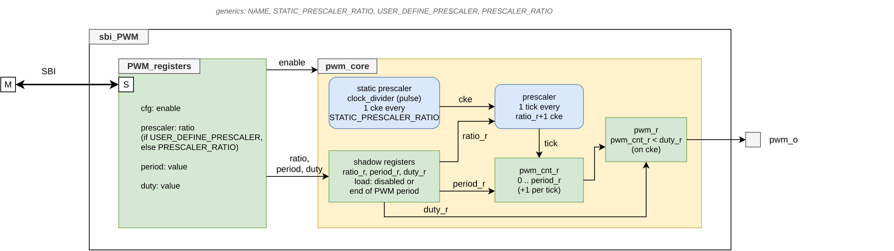
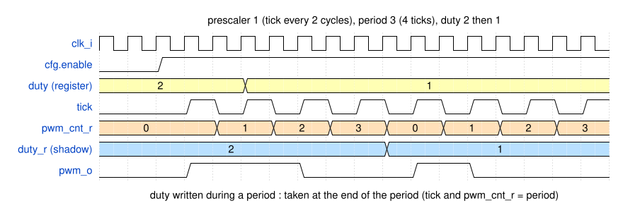

<!--
  README MODEL (common to every Asylum IP, keep the same headings)
  ----------------------------------------------------------------
  Regenerate from the sources, never from the previous README text alone:
    hdl/*.vhd (entities, generics, ports), hdl/csr/*.hjson (register map),
    <IP>.core (VLNV, targets, depends), mk/targets.txt, sim/, syn/, esw/.
  Sections, in this order:
    badges / title + one-line pitch / Overview / Features / Block Diagram /
    Getting Started / Hardware Interfaces / Configuration / Resources /
    Theory of Operation / Registers / Programmer's Guide /
    Design Verification / Dependencies and Related IPs / License
  Rules:
    - English, short and factual: every statement backed by the sources.
    - No VLNV line: the version badge shows it.
    - Badges: first line version, license; second line CI, lint, sim, syn.
    - Block diagram and FSM: pages Overview and FSM of doc/<NAME>.drawio, exported to
      doc/<NAME>-Overview.png and doc/<NAME>-FSM.png (make -C doc).
    - Timing diagrams: WaveDrom source doc/<NAME>-<what>.json, rendered
      doc/<NAME>-<what>.svg (make -C doc), shown as images.
    - No CPU named (OpenBlaze, PicoBlaze, RISC-V) outside the CPU and SoC IPs.
    - Registers: link to the generated hdl/csr/<X>_csr.md, never copy the tables.
    - Tables: Configuration = Name|Type|Default|Description,
      Hardware Interfaces = Name|Direction|Type|Description, grouped by interface.
    - A section with nothing to say is one line ("This IP has no
      software-visible registers."), never removed.
-->
[](https://github.com/deuskane/asylum-component-pwm/tags)
[](LICENSE)

[](https://github.com/deuskane/asylum-component-pwm/actions/workflows/ci.yml)
[](https://github.com/deuskane/asylum-component-pwm/actions/workflows/ci.yml)
[](https://github.com/deuskane/asylum-component-pwm/actions/workflows/ci.yml)
[](https://github.com/deuskane/asylum-component-pwm/actions/workflows/ci.yml)

# PWM

**A small, readable PWM generator in VHDL: one output, 8-bit prescaler, period and duty, optional static prescaler, glitch-free updates at the start of the next period.**

Part of the [Asylum project](https://github.com/deuskane/asylum-project), a collection of small IP cores, written to be read and learned from.

## Table of Contents

1. [Overview](#overview)
2. [Features](#features)
3. [Block Diagram](#block-diagram)
4. [Getting Started](#getting-started)
5. [Hardware Interfaces](#hardware-interfaces)
6. [Configuration](#configuration)
7. [Resources](#resources)
8. [Theory of Operation](#theory-of-operation)
9. [Registers](#registers)
10. [Programmer's Guide](#programmers-guide)
11. [Design Verification](#design-verification)
12. [Dependencies and Related IPs](#dependencies-and-related-ips)
13. [License](#license)

## Overview

This IP generates a PWM (Pulse Width Modulation) signal: LED dimming, motor speed, servo position. Software drives it through four 8-bit registers on the SBI bus (the simple bus of Asylum): `cfg` (enable), `prescaler` (duration of a tick), `period` (ticks of a PWM period) and `duty` (ticks of the high phase).

A static prescaler, set by a generic (`STATIC_PRESCALER_RATIO`), divides the clock before the prescaler to reach low frequencies (50 Hz for a servo) with 8-bit registers. The configuration is copied into shadow registers at the start of each PWM period: software writes it at any time, without status or interrupt, and the output never glitches.

The PWM itself is `pwm_core`, independent of the registers and of the bus (plain configuration signals, generic widths): it can be used alone with wider counters.

## Features

- One output `pwm_o`, driven by a flip-flop
- PWM period of `(period + 1) x (prescaler + 1) x STATIC_PRESCALER_RATIO` clock cycles, high phase of `duty` ticks; duty 0: always low, duty greater than period: always high
- Static prescaler: one prescaler step every `STATIC_PRESCALER_RATIO` clock cycles (a `clock_divider` in pulse mode used as a clock enable, no clock buffer); 1: none
- `prescaler`, `period` and `duty` taken into account at the start of the next PWM period: no truncated or doubled pulse, no counter overflow
- Disable: counter cleared, output low one clock cycle after the write; enable: the first period starts with its high phase on the next step of the static prescaler
- Prescaler register optional (`USER_DEFINE_PRESCALER`), reset or fixed value `PRESCALER_RATIO` (1 kHz with a 50 MHz clock and the reset value of `period`)
- Zero wait state bus accesses

## Block Diagram



## Getting Started

The cores of the Asylum IPs are published in the FuseSoC library [asylum-cores](https://github.com/deuskane/asylum-cores) (with the UVVM core used by the testbenches):

```bash
pip install fusesoc
fusesoc library add https://github.com/deuskane/asylum-cores
fusesoc run --target sim_pwm_update_duty asylum:component:PWM  # needs GHDL
```

To use the IP in your design, add `asylum:component:PWM` to the `depend` list of your core and instantiate `sbi_PWM` (library `asylum`):

```vhdl
library asylum;
use     asylum.sbi_pkg.all;
use     asylum.pwm_pkg.all;

  -- Servo : 50 Hz with a 50 MHz clock (prescaler = 249, period = 199)
  ins_pwm : sbi_PWM
    generic map
    ( NAME                   => "PWM0"
     ,STATIC_PRESCALER_RATIO => 20
     ,USER_DEFINE_PRESCALER  => true
     ,PRESCALER_RATIO        => x"F9"
    )
    port map
    ( clk_i     => clk
     ,arst_b_i  => arst_b
     ,sbi_ini_i => sbi_ini           -- 2 address bits, 8-bit data
     ,sbi_tgt_o => sbi_tgt
     ,pwm_o     => pwm0
    );
```

## Hardware Interfaces

Top-level entity: **`sbi_PWM`** ([hdl/sbi_PWM.vhd](hdl/sbi_PWM.vhd)), component in `asylum.pwm_pkg`.

### Clock and Reset

| Name | Direction | Type | Description |
|------|-----------|------|-------------|
| `clk_i` | in | std_logic | System clock, the only clock of the IP |
| `arst_b_i` | in | std_logic | Asynchronous reset, active low |

### Bus (SBI)

| Name | Direction | Type | Description |
|------|-----------|------|-------------|
| `sbi_ini_i` | in | sbi_ini_t | Request from the initiator (`cs`, `re`, `we`, `addr`, `wdata`); 2 address bits, 8-bit data |
| `sbi_tgt_o` | out | sbi_tgt_t | Response to the initiator (`ready`, always `'1'`, `rdata`, `info`) |

### PWM

| Name | Direction | Type | Description |
|------|-----------|------|-------------|
| `pwm_o` | out | std_logic | PWM output, from a flip-flop, low while the PWM is disabled |

<details>
<summary><b>pwm_core</b>: the PWM without the registers</summary>

[hdl/pwm_core.vhd](hdl/pwm_core.vhd), component in `asylum.pwm_pkg`. Same `clk_i`, `arst_b_i` and `pwm_o` as the top level, and the configuration as plain signals:

| Name | Direction | Type | Description |
|------|-----------|------|-------------|
| `cfg_enable_i` | in | std_logic | 0: counter cleared, `pwm_o` low, shadow registers loaded every cycle; 1: PWM running |
| `cfg_prescaler_ratio_i` | in | std_logic_vector(PRESCALER_WIDTH-1 downto 0) | Duration of a tick minus one, in steps of the static prescaler |
| `cfg_period_i` | in | std_logic_vector(COUNTER_WIDTH-1 downto 0) | PWM period minus one, in ticks |
| `cfg_duty_i` | in | std_logic_vector(COUNTER_WIDTH-1 downto 0) | High phase, in ticks (greater than `cfg_period_i`: always high) |

Generics: `STATIC_PRESCALER_RATIO` (as `sbi_PWM`), `PRESCALER_WIDTH` and `COUNTER_WIDTH` (natural, default 8; `sbi_PWM` uses 8 and 8).

</details>

## Configuration

| Name | Type | Default | Description |
|------|------|---------|-------------|
| `NAME` | string | `""` | Instance name, visible in `sbi_tgt_o.info` |
| `STATIC_PRESCALER_RATIO` | positive | `1` | Clock cycles per step of the prescaler. 1: no static prescaler. 20: 50 Hz with a 50 MHz clock, `prescaler = 249` and `period = 199` |
| `USER_DEFINE_PRESCALER` | boolean | `true` | `true`: the `prescaler` register exists; `false`: the ratio is fixed to `PRESCALER_RATIO` and the `prescaler` address reads 0 |
| `PRESCALER_RATIO` | std_logic_vector(7 downto 0) | `x"C2"` | Reset value (or fixed value) of the prescaler ratio; `x"C2"`: 1001.6 Hz with a 50 MHz clock, `STATIC_PRESCALER_RATIO = 1` and `period = 0xFF` |

## Resources

Figures of the `syn_*` targets (`make nonreg_syn`, see [Targets](#targets)): [syn/sbi_PWM_wrapper.vhd](syn/sbi_PWM_wrapper.vhd) with the generics of each configuration, synthesized by Yosys and its GHDL plugin; the reports are in the build directory of each target.

| Configuration | LUT¹ | LUTRAM¹ | FF¹ | CARRY4¹ | MUXF7/F8¹ | BRAM¹ | DSP¹ | Area² (µm²) | kGE³ |
|---|---|---|---|---|---|---|---|---|---|
| `syn_default` (default generics) | 65 | 0 | 66 | 5 | 17 | 0 | 0 | 2977.86 | 0.793 |
| `syn_fixed_prescaler` (no prescaler register, ratio fixed to 2) | 49 | 0 | 51 | 5 | 9 | 0 | 0 | 2212.12 | 0.589 |
| `syn_static_prescaler` (`STATIC_PRESCALER_RATIO = 20`) | 86 | 0 | 72 | 7 | 38 | 0 | 0 | 3159.28 | 0.842 |

¹ Xilinx Artix-7 (LUT6), Yosys 0.33 `synth_xilinx -flatten -noiopad -noclkbuf`, before place and route: every cell of the netlist is counted, Vivado may differ. Identical cells are merged as a vendor tool does (`opt_merge -share_all`): the inverters of an active-low reset net become one; every remaining cell is counted, an `INV` as a `LUT1` (9 of the 65 LUTs of `syn_default`). The IP has no memory: no LUTRAM, no BRAM. Flip-flops of `syn_default`: 25 register bits (`cfg`, `prescaler`, `period`, `duty`), 24 shadow bits, the prescaler and PWM counters (8 + 8) and the output; the static prescaler (`clock_divider`) adds 6.

² SkyWater sky130 `sky130_fd_sc_hd`, typical corner (tt, 25 °C, 1.80 V), Yosys 0.33 `synth` + `dfflibmap` + `abc -liberty`: standard-cell area only, no timing constraint, no buffering, clock tree or placement.

³ Area in thousands of NAND2 gate equivalents (`sky130_fd_sc_hd__nand2_1` = 3.7536 µm²).

## Theory of Operation

### Hierarchy

| File | Unit | Role |
|------|------|------|
| [hdl/sbi_PWM.vhd](hdl/sbi_PWM.vhd) | `sbi_PWM` | Top level: `PWM_registers` + `pwm_core` (8-bit prescaler, 8-bit counter) |
| [hdl/pwm_core.vhd](hdl/pwm_core.vhd) | `pwm_core` | Static prescaler, shadow registers, prescaler, PWM counter, output register |
| [hdl/pwm_pkg.vhd](hdl/pwm_pkg.vhd) | `pwm_pkg` | Components |
| `hdl/csr/PWM_csr.vhd` | `PWM_registers` | Register bank, generated by regtool from [hdl/csr/PWM.hjson](hdl/csr/PWM.hjson) |

### Ticks, period and duty

- **Static prescaler**: a `clock_divider` of `asylum:component:clock_divider` in pulse mode gives `cke`, one clock cycle every `STATIC_PRESCALER_RATIO` (S) cycles. It is a clock enable, not a clock: no clock buffer, no generated clock. With S = 1 there is no `clock_divider` and `cke` is always 1.
- **Prescaler**: a down counter of the `cke` pulses gives a tick every `ratio + 1` pulses: a tick lasts `T = S x (ratio + 1)` clock cycles.
- **PWM counter**: counts the ticks from 0 to `period`, then restarts at 0: a PWM period is `(period + 1) x T` clock cycles, `f_pwm = f_clk / ((period + 1) x (ratio + 1) x S)`.
- **Output**: `pwm_r` is `counter < duty`, registered on the `cke` pulses: high during the first `duty` ticks of each period, every edge with the same latency, so the durations are exact.



Examples with a 50 MHz clock:

| Use | STATIC_PRESCALER_RATIO | prescaler | period | PWM frequency | Duty step |
|-----|------------------------|-----------|--------|---------------|-----------|
| Reset values (LED dimming) | 1 | 194 (`0xC2`) | 255 | 1001.6 Hz | 1/256 |
| Motor | 1 | 9 | 249 | 20 kHz | 1/250 |
| Maximum resolution, fastest | 1 | 0 | 255 | 195.3 kHz | 1/256 |
| Slowest without static prescaler | 1 | 255 | 255 | 762.9 Hz | 1/256 |
| Servo (pulse 1 to 2 ms: duty 10 to 20) | 20 | 249 | 199 | 50 Hz | 100 µs |

100 % needs `duty > period`, so `period <= 254`.

### Shadow registers

`ratio`, `period` and `duty` are copied into shadow registers on the last tick of each PWM period, and every cycle while the PWM is disabled. A write is taken into account at the start of the next period:

- the current pulse is never truncated nor doubled (duty changed during the high or the low phase);
- the current period is never extended nor shortened, and the counter never goes beyond the period in use (period decreased below the current count);
- every tick of a period has the same duration (prescaler changed during a period).

Each register is copied on its own: if a period ends between two writes (`period` then `duty`), one period uses the new `period` with the old `duty`. To change several values at once, write them with `cfg.enable = 0`.

### Enable

- `cfg.enable = 0`: the counter is cleared, `pwm_o` is low one clock cycle after the write, the shadow registers follow the registers.
- `cfg.enable = 1`: the first period starts with its high phase on the first `cke` pulse after the write (one clock cycle after it when S = 1, at most S cycles after), with the values written before. Its first tick lasts `T` cycles like the others. The static prescaler runs freely: the edges of `pwm_o` are aligned on its pulses.

## Registers

Four 8-bit registers (2 address bits): `cfg` (0x0, bit `enable`), `prescaler` (0x1, only when `USER_DEFINE_PRESCALER = true`), `period` (0x2), `duty` (0x3). Reset values: `cfg = 0x00`, `prescaler = PRESCALER_RATIO`, `period = 0xFF`, `duty = 0x00`. They read back as written; the PWM uses their shadow copies.

- Register documentation: **[hdl/csr/PWM_csr.md](hdl/csr/PWM_csr.md)**
- C header: [hdl/csr/PWM_csr.h](hdl/csr/PWM_csr.h)
- Source: [hdl/csr/PWM.hjson](hdl/csr/PWM.hjson) (regtool)

## Programmer's Guide

### Initialization

1. Write `cfg` = 0 (disable: the shadow registers follow the registers).
2. Write `prescaler` (if present), `period` and `duty`.
3. Set `cfg.enable`: the first period starts with its high phase.

### While running

Write `duty` (or `period`, `prescaler`) at any time: the value is used from the next PWM period, there is nothing to poll. `cfg` can be read-modify-written: writing `enable = 1` again does not restart the period.

### Example

The registers are 8 bits wide, at consecutive byte addresses from the base address of the IP (`0x40003000` is an example, use the address map of your SoC).

```c
#include <stdint.h>
#include "PWM_csr.h"

#define PWM_BASE ((uintptr_t)0x40003000u)   // example base address

static inline void reg_wr(uintptr_t base, uint32_t offset, uint8_t data)
{
  *(volatile uint8_t *)(base + offset) = data;
}

static inline uint8_t reg_rd(uintptr_t base, uint32_t offset)
{
  return *(volatile uint8_t *)(base + offset);
}

// Start the PWM : configuration written while disabled, then enable
void pwm_start(uint8_t prescaler, uint8_t period, uint8_t duty)
{
  reg_wr(PWM_BASE, PWM_CFG      , 0x00);                    // disable : counter cleared, pwm_o low
  reg_wr(PWM_BASE, PWM_PRESCALER, prescaler);               // tick = (prescaler+1) x STATIC_PRESCALER_RATIO cycles
  reg_wr(PWM_BASE, PWM_PERIOD   , period);                  // PWM period = period+1 ticks
  reg_wr(PWM_BASE, PWM_DUTY     , duty);                    // high during duty ticks
  reg_wr(PWM_BASE, PWM_CFG      , reg_rd(PWM_BASE, PWM_CFG) | (1u << PWM_CFG_ENABLE));
}

// Change the duty while running : taken at the start of the next PWM period
void pwm_set_duty(uint8_t duty)
{
  reg_wr(PWM_BASE, PWM_DUTY, duty);
}

void pwm_stop(void)
{
  reg_wr(PWM_BASE, PWM_CFG, reg_rd(PWM_BASE, PWM_CFG) & (uint8_t)~(PWM_CFG_ENABLE_MASK << PWM_CFG_ENABLE));
}

// Servo with STATIC_PRESCALER_RATIO = 20 and a 50 MHz clock : 50 Hz, a tick
// of 100 us, pulse of 1 ms (duty 10) to 2 ms (duty 20)
void servo_init(void)
{
  pwm_start(249, 199, 15);                                  // center : 1.5 ms
}
```

## Design Verification

### Testbenches

| File | DUT | Description |
|------|-----|-------------|
| [sim/pwm/tb_PWM.vhd](sim/pwm/tb_PWM.vhd) | `sbi_PWM` | Self-checking UVVM testbench with the SBI BFM, generics `TESTS_LIST` (scenarios, see below) and the generics of the DUT: the expected durations are computed from them. The high phase and the period of `pwm_o` are measured in clock cycles and checked exactly, and every edge is checked not to come early. Scenarios in `tb_PWM_<name>_pkg`, names and dispatch in [tb_PWM_tests_pkg](sim/pwm/tb_PWM_tests_pkg.vhd) |
| [sim/pwm_core/tb_pwm_core.vhd](sim/pwm_core/tb_pwm_core.vhd) | `pwm_core` | Self-checking UVVM testbench of `pwm_core` alone, configuration driven directly, generics `TESTS_LIST`, `PRESCALER_WIDTH`, `COUNTER_WIDTH`: the values of the scenarios come from the widths (maximum ratio, maximum period). Scenarios in `tb_pwm_core_<name>_pkg`, names and dispatch in [tb_pwm_core_tests_pkg](sim/pwm_core/tb_pwm_core_tests_pkg.vhd) |

The helpers of both testbenches (register accesses, configuration, measurement of `pwm_o`, reset pulse) are in [sim/common/tb_PWM_bfm_pkg.vhd](sim/common/tb_PWM_bfm_pkg.vhd).

### Scenarios (`TESTS_LIST`)

The scenarios are chosen at run time with the generic `TESTS_LIST`: names separated by `,` without space (`duty,update_duty,duty`), a name may be repeated. The sequencer first checks every name (an unknown name is a `TB_ERROR` before any scenario runs), then for each scenario drives a reset pulse with the bus inactive, logs `TEST <i>/<N> : <name>` and runs it: each scenario starts from reset and configures the DUT itself. The empty list (default) only compiles and elaborates the testbench. The list is parsed and its names checked with `list_length` / `list_item` / `list_contains` of `asylum.string_pkg` (`asylum:utils:pkg` >= 1.10.0).

`tb_PWM` (checks counted as the `=> OK` lines of the log, reference configuration: default generics):

| Name | Checks | Description |
|------|--------|-------------|
| `reset_values` | 5 | Reset values of the registers (`prescaler`: `PRESCALER_RATIO`, 0 if not implemented), `pwm_o` low |
| `registers` | 14 | Read and write of `prescaler`, `period`, `duty` with a different pattern each, then the inverted one; only `cfg.enable` is implemented |
| `disabled` | 2 | Configured but not enabled: `pwm_o` stays low |
| `no_prescaler` | 26 | Prescaler 0, period 10 ticks, duty 3: start one cycle after the enable, 4 periods |
| `prescaler` | 20 | Prescaler 4, period 8 ticks, duty 5: start latency, 3 periods |
| `duty` | 38 | Duty 0 (always low), 1, `period` (low during one tick), `period + 1` and 255 (always high) |
| `period_0` | 6 | Period of one tick: duty 0 always low, duty 1 always high |
| `update_duty` | 31 | Duty decreased during the high phase (no truncated pulse), increased during the low phase (no second pulse), used from the next period; `cfg` written again without restarting the period |
| `update_period` | 32 | Period increased during the low phase (current period not extended), period and duty decreased below the counter (no overflow) |
| `update_prescaler` | 23 | Prescaler decreased during a period: the current period keeps its ticks (needs `USER_DEFINE_PRESCALER = true`, a `TB_ERROR` otherwise) |
| `disable_enable` | 44 | Disable during the high phase (`pwm_o` low one cycle later, not delayed by the static prescaler), during the low phase (counter cleared): each enable starts a complete period |
| `frequency` | 14 | Reset values of `prescaler` and `period`, duty 50 %: 1001.6 Hz with the default generics |
| `servo` | 14 | Prescaler 249, period 199, duty 15: 1.5 ms pulse every 20 ms with `STATIC_PRESCALER_RATIO = 20` |
| `async_reset` | 10 | Reset asserted while `pwm_o` is high: `pwm_o` low without clock edge, registers back to their reset values, `pwm_o` stays low |

`tb_pwm_core` (4-bit prescaler, 12-bit counter):

| Name | Checks | Description |
|------|--------|-------------|
| `prescaler` | 16 | Maximum ratio (16 cycles per tick), period 1000 ticks, duty a quarter; low while disabled |
| `full_period` | 14 | Maximum period (4096 ticks), duty half |
| `update_duty` | 20 | Maximum duty written at the start of a period: current period unchanged, low during one tick from the next one |
| `always_high` | 4 | Duty greater than period: always high |

### Targets

| Target | Toplevel | Description |
|--------|----------|-------------|
| `default` | `sbi_PWM` | HDL fileset + generation of the register bank (not a simulation) |
| `sim_pwm` | `tb_PWM` | Reference configuration of `tb_PWM` (default generics): build and elaboration only (`TESTS_LIST` empty), base of the scenario targets and of the list runs |
| `sim_pwm_<name>` | `tb_PWM` | One target per scenario: `sim_pwm_reset_values`, `_registers`, `_disabled`, `_no_prescaler`, `_prescaler`, `_duty`, `_period_0`, `_update_duty`, `_update_period`, `_update_prescaler`, `_disable_enable`, `_frequency`, `_servo`, `_async_reset` (279 checks in all) |
| `sim_pwm_fixed_prescaler` | `tb_PWM` | `USER_DEFINE_PRESCALER = false`, `PRESCALER_RATIO = x"02"`: every scenario but `update_prescaler` (256 checks) |
| `sim_pwm_static_prescaler` | `tb_PWM` | `STATIC_PRESCALER_RATIO = 20`: every scenario (279 checks) |
| `sim_pwm_core` | `tb_pwm_core` | `pwm_core` with a 4-bit prescaler and a 12-bit counter: build and elaboration only |
| `sim_pwm_core_<name>` | `tb_pwm_core` | One target per scenario: `sim_pwm_core_prescaler`, `_full_period`, `_update_duty`, `_always_high` (54 checks in all) |
| `lint_ghdl` | `asylum.sbi_PWM_wrapper` | GHDL `-Wall` analysis and elaboration of [syn/sbi_PWM_wrapper.vhd](syn/sbi_PWM_wrapper.vhd) (`sbi_PWM` with flat SBI ports) |
| `lint_ghdl_synth_<config>` | `asylum.sbi_PWM_wrapper` | `ghdl --synth` check (no latch, synthesizable): `default`, `fixed_prescaler`, `static_prescaler` (the configurations of the `sim_pwm*` targets) |
| `syn_<config>` | `asylum.sbi_PWM_wrapper` | Synthesis with Yosys, Artix-7 and sky130 (see [Resources](#resources)), same configurations as `lint_ghdl_synth_*`: `syn_default`, `syn_fixed_prescaler`, `syn_static_prescaler` |

The reference configuration of a testbench has a build-only base target and one target per scenario: one CI job per scenario, a failure is isolated. Every other configuration has one target that runs its whole list: the `TEST <i>/<N>` header names a failing scenario. FuseSoC replaces the `parameters` list of an inherited target, so each target repeats the generics of its configuration.

Every `sim_*`, `lint_*` and `syn_*` target is a job of the [GitHub CI](https://github.com/deuskane/asylum-component-pwm/actions/workflows/ci.yml), run in the [asylum-env](https://github.com/deuskane/asylum-ci) image (GHDL, FuseSoC, UVVM, Yosys). The `sim`, `lint` and `syn` badges count the passed and failed targets of the last run on `main`.

### How to Run

From a clone of [asylum-project](https://github.com/deuskane/asylum-project) (GHDL and FuseSoC installed, or in the asylum-env image):

```bash
make help                        # variables, rules and targets
make sim_pwm_update_duty         # one scenario, log in log/
make sim_pwm_static_prescaler    # every scenario of a configuration
make nonreg_sim                  # every sim_* target
make nonreg_lint                 # every lint_* target
make nonreg_syn                  # every syn_* target (Yosys, figures of Resources)
make TARGETS_FILTER=^sim_pwm_core nonreg_sim
```

To run a list of scenarios, build the testbench once, then run the list without recompiling, either with FuseSoC (same `--build-root` and `--no-export` as the Makefile, so that the build of the target is reused; any generic of the target can be overridden after the VLNV):

```bash
make sim_pwm                     # build and elaboration (TESTS_LIST empty)
fusesoc --cores-root . run --build-root build --no-export --run --target sim_pwm asylum:component:PWM:1.0.0 --TESTS_LIST=duty,update_duty,duty
```

or in the build directory of the target. `EXTRA_OPTIONS` replaces every generic set by the target: repeat the generics of the configuration, else their default values apply:

```bash
cd build/asylum_component_PWM_1.0.0/sim_pwm-ghdl
make run EXTRA_OPTIONS="-gTESTS_LIST=duty,servo -gSTATIC_PRESCALER_RATIO=20"
```

To add a scenario: a `tb_PWM_<name>_pkg` package with a `run` procedure in the `sim_pwm` fileset, its name in `C_TESTS` and its case in `run_test` of [tb_PWM_tests_pkg](sim/pwm/tb_PWM_tests_pkg.vhd), a `sim_pwm_<name>` target and the name in the `TESTS_LIST` of the other configurations in [PWM.core](PWM.core), then `make mk/targets.txt` and `make ci_generate`.

Outside the CI, GHDL writes a waveform `dut.fst`.

## Dependencies and Related IPs

| Core | Repository | Purpose |
|------|------------|---------|
| `asylum:component:clock_divider` (>= 2.1.0) | [asylum-component-clock_divider](https://github.com/deuskane/asylum-component-clock_divider) | Static prescaler of `pwm_core` (pulse mode, `BYPASS_CBUFG = true`) |
| `asylum:utils:generators` | [asylum-utils-generators](https://github.com/deuskane/asylum-utils-generators) | regtool (register generator) and the CSR building blocks |
| `asylum:utils:pkg` | [asylum-utils-pkg](https://github.com/deuskane/asylum-utils-pkg) | Common packages (`sbi_pkg`, ...); the testbenches need >= 1.10.0 (`string_pkg` lists of `TESTS_LIST`) |
| `asylum:utils:ghdl_synth` | [asylum-utils-generators](https://github.com/deuskane/asylum-utils-generators) | `ghdl --synth` check of the `lint_ghdl_synth_*` targets |
| `asylum:utils:yosys_synth` | [asylum-utils-generators](https://github.com/deuskane/asylum-utils-generators) | Yosys synthesis of the `syn_*` targets (Artix-7 and sky130) |
| `bitvis:verification:uvvm` | [UVVM](https://github.com/UVVM/UVVM) | Verification library and SBI BFM |

All the IPs: [asylum-project](https://github.com/deuskane/asylum-project).

## License

Apache License 2.0, see [LICENSE](LICENSE).
